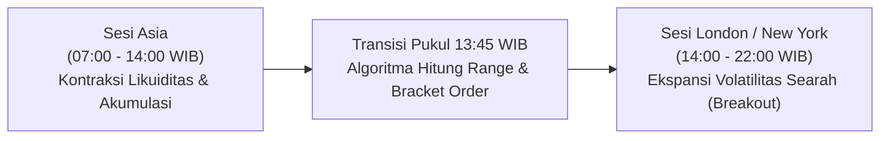

# ⚡ XAU/USD Daily Systematic Trading Strategy
### Quantitative London Breakout Volatility Expansion Model (559 Trading Days)

<div align="left">

-ffd700?style=for-the-badge)

-2ca02c?style=for-the-badge)


-purple?style=for-the-badge)


</div>

> **Model Overview:**  
> Model kuantitatif trading harian XAU/USD berbasis ekspansi volatilitas penembusan rentang Sesi Asia (London Breakout) dengan validasi Stop Loss struktural pada Midpoint (50%) dan rasio Risk to Reward asimetris 1:2.0.

### 📊 Ringkasan Metrik Kuantitatif (559 Hari / 2 Tahun)

| Parameter Metrik | Hasil Backtest |
| :--- | :--- |
| **Total Sampel Transaksi** | **559 Hari Perdagangan** (Mei 2024 – Oktober 2026) |
| **Win Rate** | **44.2%** (247 Menang / 312 Kalah) |
| **Risk to Reward (R:R)** | **1 : 2.0 Asymmetric** (Win +2.0 R / Loss -1.0 R) |
| **Net Profit** | **+64.08 R** (+14.616 Pips) |
| **Profit Factor (PF)** | **1.22** |
| **Expected Value (EV)** | **+0.11 R / trade** |
| **Performa per 100 Trade** | **+32.0 R Net** |
| **Max Drawdown** | **-7.20 R** |
| **Waktu Pemasangan Order** | **13.45 – 14.00 WIB** |
| **Model Eksekusi** | **Set-and-Forget** (Zero Screen Time) |

---

## 🎯 Tesis Pasar: Transisi Likuiditas Sesi Finansial Global

Sekitar **70% perputaran likuiditas harian** pasar emas dunia terkonsentrasi pada sesi London dan New York. 



1. **Sesi Asia (07:00 – 14:00 WIB)**: Berfungsi sebagai zona pembentukan nilai ekuilibrium (*accumulation range*) dengan volatilitas yang terkompresi.
2. **Pukul 13:45 WIB**: Algoritma mengekstrak titik tertinggi (*Asian High*), terendah (*Asian Low*), dan titik tengah (*Midpoint*).
3. **Pembukaan Sesi London (14:00 WIB)**: Masuknya volume raksasa institusi Eropa memicu penembusan batas rentang (*boundary breakout*) yang menghasilkan *directional momentum* satu arah.

---

## 🛡️ Metodologi Penentuan Stop Loss Struktural (Midpoint Invalidation Axis)

Stop Loss pada model ini **TIDAK** diletakkan di ujung rentang sebaliknya (Low/High ekstrem), melainkan tepat pada **titik tengah (Midpoint 50%) sesi Asia**:

$$\text{Midpoint} = \frac{\text{Asian High} + \text{Asian Low}}{2}$$

* **BUY STOP**: Entry di `Asian High + Buffer ($1.0)`, Stop Loss di `Midpoint`, Take Profit di `Entry + (2 * Risk)`.
* **SELL STOP**: Entry di `Asian Low - Buffer ($1.0)`, Stop Loss di `Midpoint`, Take Profit di `Entry - (2 * Risk)`.

### Mengapa Stop Loss di Midpoint?
1. **Aksioma Pembatalan Tren (*Market Invalidation*):** Jika harga menembus High, lalu berbalik turun menembus level 50% sesi Asia, berarti pembeli telah kehilangan kendali dan setup tersebut adalah penembusan palsu (*fakeout*). Posisi langsung ditutup untuk mencegah kerugian lebih besar.
2. **Realisme Target Take Profit (Kapasitas ADR Emas):** Rata-rata pergerakan harian emas berkisar $35–$55 USD. Dengan Stop Loss di Midpoint (~$18 USD), Take Profit 1:2 (~$36 USD) sangat realistis tercapai sebelum sesi New York tutup. Jika Stop Loss di ujung sebaliknya, TP harus ditaruh $70 USD yang hampir mustahil tercapai dalam satu hari.
3. **Proteksi Modal:** Memangkas separuh potensi risiko kerugian per trade.

---

## 📅 Analisis Hari dalam Seminggu (*Day-of-Week Alpha Edge*)

Pengujian empiris membuktikan bahwa performa sistem sangat bervariasi bergantung pada hari perdagangan:

| Hari | Win Rate | Net PnL (R) | Profit Factor (PF) | Status Efektivitas & Rekomendasi |
| :--- | :---: | :---: | :---: | :--- |
| **Senin** | **50.5%** | **+26.77 R** | **1.58** | 🟢 **Puncak Performa**: Aliran modal pembuka pekan bersih dan searah. |
| **Selasa** | **41.1%** | **-0.94 R** | **0.98** | 🔴 **Tidak Efektif**: Rawan *fakeout* / konsolidasi jelang data AS. |
| **Rabu** | **39.0%** | **+2.14 R** | **1.03** | 🟡 **Marginal / Hati-hati**: Tertekan antisipasi rilis CPI/FOMC. |
| **Kamis** | **49.1%** | **+26.66 R** | **1.49** | 🟢 **Sangat Kuat**: Ekspansi tren pasca rilis katalis ekonomi. |
| **Jumat** | **41.4%** | **+9.45 R** | **1.16** | 🔵 **Cukup Efektif**: Volatilitas tinggi saat overlap New York. |

---

## 🚀 Panduan Eksekusi Harian (Zero Screen-Time SOP)

Sistem ini dirancang khusus bagi individu dengan keterbatasan waktu pantau grafik:

1. **Pukul 13:45 – 14:00 WIB**:
   - Buka folder `xau_daily_trading_strategy`.
   - Klik 2x berkas `open_position.bat`.
   - Program otomatis mengambil harga *real-time* dan menghitung level tiket.
2. **Salin 2 Tiket Pending Order ke MT4 / MT5**:
   - Tiket 1: **BUY STOP** (Entry, Stop Loss Midpoint, Take Profit 1:2.0).
   - Tiket 2: **SELL STOP** (Entry, Stop Loss Midpoint, Take Profit 1:2.0).
3. **Tutup Total Aplikasi Trading (*Set-and-Forget*)**:
   - Jangan menatap chart M1/M5.
   - Saat salah satu order tersentuh (*filled*), batalkan order lawannya (Prinsip OCO).
   - Jika sampai pukul 22:00 WIB tidak ada order yang tersentuh, batalkan kedua order.

---

## 📁 Struktur Berkas Repositori

```
xau_daily_trading_strategy/
├── readme.md                           # Comprehensive Quantitative Research & Documentation
├── xau_daily_trading_strategy.ipynb    # Full Jupyter Notebook Research, Geometry & Equity Charts
├── open_position.bat                   # 1-Click Windows Execution Launcher (13:45 WIB)
├── xau_daily_signal.py                 # Live Market Feed Extraction & Position Sizing Engine
└── usage_guide.txt                     # Operational Execution Standard Operating Procedure (SOP)
```

---

## ⚙️ Persyaratan Sistem
* Python 3.10+
* Pustaka: `pandas`, `numpy`, `yfinance`, `matplotlib`
* Terminal / CMD berkemampuan UTF-8
